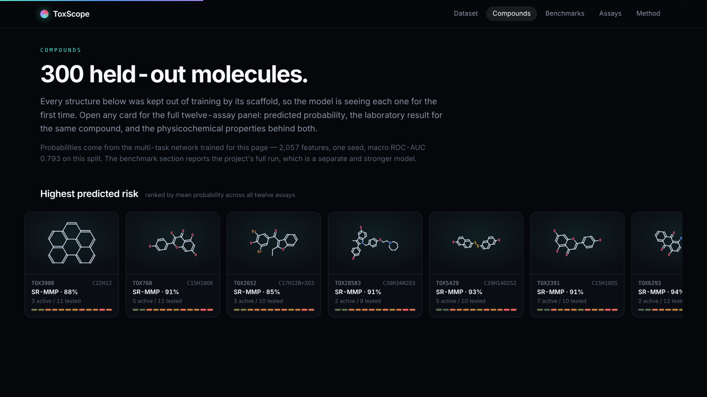
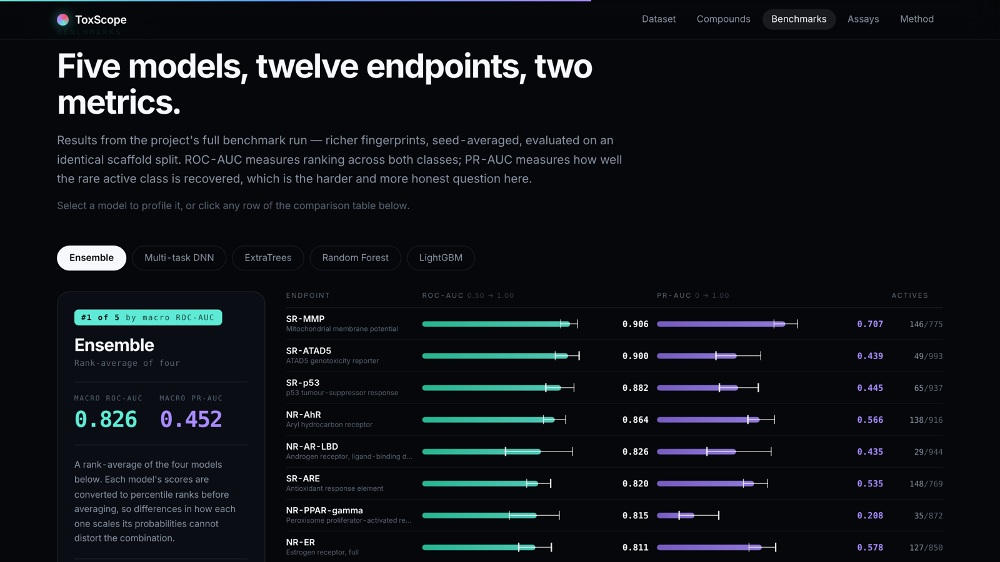

# ToxScope — multi-endpoint toxicity prediction on Tox21

A multi-task neural network that scores all twelve Tox21 assays from one chemical structure in a
single forward pass, with an interactive web app for exploring the predictions against the
laboratory ground truth.

**Project 17 — Toxicity Prediction (Tox21)** · Team I · uGDX School of Technology, ATLAS SkillTech
University · Supervisor: Prof. Dr. Rabinder Henry

**Live Site:** https://rushi1607.github.io/tox21-toxicity-prediction/

---

## What this is

Tox21 is a US inter-agency screening programme that put thousands of commercial chemicals, drugs and
pesticides through twelve biological assays — seven nuclear-receptor targets and five stress-response
reporters. It is the standard teaching set for multi-task learning in chemistry precisely because it
is messy:

- **Most compounds were never tested on most assays.** Between 7.3% and 26.0% of each assay column is
  empty. A blank is *not* a negative result, and treating it as one is the most common error on this
  dataset.
- **Actives are rare.** Active rates run from 2.85% (NR-PPAR-γ) to 16.27% (SR-ARE). A model that
  answered "inactive" to everything would score above 84% accuracy on every endpoint, which is why
  accuracy is never reported here.

The model handles both with a **masked, class-weighted binary cross-entropy**: a binary mask zeroes
every untested assay before the sum, so missing labels contribute exactly zero gradient.

## Results

Full benchmark run, evaluated on an identical scaffold split. Every score carries a 95% confidence
interval from 1,000 stratified bootstrap resamples.

| Model | Macro ROC-AUC | Macro PR-AUC | Endpoints led | Configuration |
|---|---|---|---|---|
| **Ensemble** | **0.826** | **0.452** | 3 / 12 | Rank-average of the four below |
| Multi-task DNN | 0.825 | 0.423 | 5 / 12 | One network, 12 sigmoid heads, 5 seeds |
| ExtraTrees | 0.814 | 0.418 | 2 / 12 | 500 trees per endpoint |
| Random Forest | 0.810 | 0.418 | 1 / 12 | 500 trees per endpoint |
| LightGBM | 0.795 | 0.407 | 1 / 12 | 600 trees, lr 0.03, 15 leaves |

The multi-task network beats every single-task baseline on macro ROC-AUC and leads on more individual
endpoints than the ensemble does, which is the result the project set out to test: whether sharing one
representation across twelve assays earns its complexity.

Per-endpoint scores, confidence intervals and the paired significance test are in
[`data/Tox21_v2_results_with_CI.csv`](data/Tox21_v2_results_with_CI.csv) and rendered in the app.

## The web app

A single self-contained HTML page — no build step, no runtime dependencies, no network calls.

| | |
|---|---|
|  |  |

- **Compounds** — 300 held-out molecules in browsable rails, each drawn from real RDKit 2D
  coordinates. Open one for the full twelve-assay panel: predicted probability beside the laboratory
  result, the assay's base rate, the model's held-out AUC for that head, and eight computed
  physicochemical properties.
- **Benchmarks** — all five models across both metrics, with confidence whiskers and a model profile.
- **Assays** — what each of the twelve endpoints biologically measures, with its class balance.
- **Method** — the six decisions that keep the score honest.

The probabilities shown in the app come from the model trained by [`src/pipeline.py`](src/pipeline.py)
(2,057 features, single seed, macro ROC-AUC **0.793** on its split). The benchmark section reports the
project's full run, which uses richer fingerprints and seed averaging — the two are labelled
separately in the UI and should not be conflated.

## Repository layout

```
index.html                      the built app — open this in a browser
src/
  pipeline.py                   featurise, scaffold-split, train, evaluate
  export_app_data.py            build the app's JSON payload (structures, labels, predictions)
  build.py                      inline CSS + JS + data into index.html
  app/
    template.html               page structure
    style.css                   design system
    app.js                      rendering, molecule drawing, interactions
  app_data.json                 generated payload consumed by the page
data/
  tox21_cleaned_final.csv       7,714 compounds × 12 assay labels
  Tox21_v2_results_with_CI.csv  benchmark results with bootstrap CIs
  figures/                      figures from the full training run
notebooks/
  Tox21_multitask_model.ipynb   the original training notebook
docs/                           screenshots used in this README
```

## Reproducing

```bash
pip install -r requirements.txt

python src/pipeline.py          # featurise, split, train, evaluate  (~5 min on CPU)
python src/export_app_data.py   # structures, labels and predictions -> src/app_data.json
python src/build.py             # -> index.html
```

`pipeline.py` prints the per-epoch validation macro ROC-AUC, the final held-out score and a
per-endpoint breakdown. It asserts that no Bemis–Murcko scaffold appears in more than one split and
fails the run if one does.

To change only the page's design, edit `src/app/` and re-run `src/build.py` — no retraining needed.

## Method

1. **Standardise** — RDKit parses every SMILES string, strips counter-ions to the largest fragment,
   neutralises formal charges and writes a canonical form.
2. **Featurise** — a 2,048-bit ECFP4 fingerprint (Morgan, radius 2) plus nine physicochemical
   descriptors, clipped at the 1st and 99th percentiles and standardised. 2,057 features per molecule.
3. **Split by scaffold** — molecules grouped by Bemis–Murcko scaffold; a group never spans two splits,
   and the largest groups are routed to training so they cannot dominate the test set.
4. **Mask the loss** — a binary mask inside the cross-entropy zeroes untested assays. Positive weights
   are square-root tempered so endpoints near 3% prevalence still train without destabilising the
   shared trunk.
5. **Benchmark fairly** — every baseline is fitted per endpoint on exactly the compounds tested for
   that assay, using the same features and the same split.
6. **Quantify uncertainty** — 1,000 stratified bootstrap resamples per score; a paired test compares
   models on identical resamples, so a difference is only called real when the interval excludes zero.

Architecture: `2,057 → 512 (BN, dropout 0.30) → 256 (BN, dropout 0.30) → 128 (dropout 0.20) → 12 sigmoid`

## Deploying

The app is a single static file, so any static host serves it as-is. On GitHub Pages — which requires
a public repository on the free plan — set **Settings → Pages → Source: Deploy from a branch →
`main` / `(root)`**. No workflow or build step is needed.

## Scope and limitations

**A Tox21 model predicts the outcome of a specific in-vitro assay — one protein target or one cellular
stress reporter, in a dish. It does not predict whether a substance is safe or harmful to a person.**
Nothing in this repository should be used to make claims about any real product, food, cosmetic,
medicine or environmental sample. Assay signal is a starting point for further testing, never a
conclusion.

Further limitations worth stating plainly:

- **Applicability domain.** Predictions are only meaningful for molecules chemically similar to the
  training set. The app gives no similarity estimate, so an unusual scaffold may be scored
  confidently and wrongly.
- **Assay noise.** Tox21 labels come from high-throughput screens with their own false-positive and
  false-negative rates. The ceiling on any model here is set partly by the data.
- **Per-endpoint reliability varies widely.** NR-AR is far weaker than SR-MMP. The app shows each
  head's held-out AUC next to its prediction for exactly this reason.

## Credits

Team I — Ramleen Singh Matharu (2513119), Rushi Chamaria (2505676), Rohan Nagdev (2513857),
Neil Patel (2507954).

Data from the [Tox21](https://tox21.gov/) public screening programme. Structures standardised with
[RDKit](https://www.rdkit.org/).
